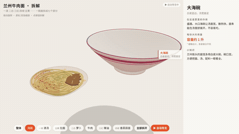
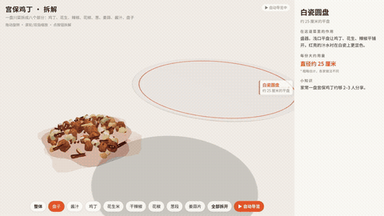

# 菜肴拆解 / Dish Teardown

把一盘中国菜拆成可以单独查看的食材层：旋转、点选、看每样东西在菜里的作用和大约用量。

灵感来自 [Elvar 的机器拆解](https://x.com/elvar_official/status/2116174609355571402)——一个可以转、可以炸开的 3D 模型。这里把同样的想法用在了菜上。




## 菜品

### 兰州牛肉面（3D 模型）

按「一清、二白、三红、四绿、五黄」拆成七层，另加大海碗。

| 部分 | 对应 | 作用（简述） | 大约用量 |
| --- | --- | --- | --- |
| 清汤 | 一清 | 牛骨慢熬的清汤，整碗面的灵魂 | 约 400–500 毫升 |
| 白萝卜片 | 二白 | 煮至半透明，清甜解腻 | 约 4–6 片（30–50 克） |
| 油泼辣子 | 三红 | 红亮浮在汤面，香而不燥 | 约 1–2 汤匙（10–20 克） |
| 香菜 · 蒜苗 | 四绿 | 提香增色 | 约 5–10 克 |
| 手工拉面 | 五黄 | 黄亮筋道的主食 | 约 150–250 克（熟面） |
| 牛肉片 | — | 腱子肉切薄片 | 约 30–50 克 |
| 大海碗 | — | 大口白瓷蓝边海碗 | 容量约 1 升 |

离线演示：[demo/lanzhou-beef-noodle/index.html](demo/lanzhou-beef-noodle/index.html)  
导览视频：[media/noodle_teardown.mp4](media/noodle_teardown.mp4)（约 28 秒，1920×1080）

### 宫保鸡丁（3D 模型）

拆成八个部分。先做了第一版建模，后来对照五张真实菜品照片改了鸡丁等材质，成为现在这个版本。第一版源码仍保留在 `src/dishes/dish_kungpao_v1.js`。

| 部分 | 作用（简述） | 大约用量 |
| --- | --- | --- |
| 鸡丁 | 主料，上浆滑炒后裹汁 | 约 250–300 克 |
| 花生米 | 出锅前拌入，保持酥脆 | 约 50–80 克 |
| 干辣椒段 | 炝出「糊辣」香 | 约 10–15 段（5–10 克） |
| 花椒 | 点缀麻味 | 约 1 小匙（2–3 克） |
| 葱段 | 与鸡丁同炒提香 | 约 2–3 根葱白（约 50 克） |
| 姜片 · 蒜片 | 底味香料 | 姜约 10 克、蒜约 3–4 瓣 |
| 宫保酱汁（荔枝味汁） | 糖醋比例先甜后酸 | 约 50–70 毫升 |
| 白瓷圆盘 | 浅口平盘衬出红亮汁水 | 直径约 25 厘米 |

离线演示：[demo/kung-pao-chicken/index.html](demo/kung-pao-chicken/index.html)  
导览视频：[media/kungpao_teardown.mp4](media/kungpao_teardown.mp4)（约 30 秒，1920×1080）

### 宫保鸡丁（照片版）

不再用程序建模，而是把真实菜品照片切成各部分，点按钮单独查看。照片来自 Wikimedia Commons，来源见 [references/sources.txt](references/sources.txt)。拆解项目与 3D 版相同（鸡丁、花生、辣椒、花椒、葱、姜蒜、酱汁、盘子）。

离线演示：[photo-version/index.html](photo-version/index.html)（单文件，图片已内嵌）  
导览视频：[media/kungpao_photo_teardown.mp4](media/kungpao_photo_teardown.mp4)（约 19 秒，1280×720）

## 如何打开演示

3D 页面和照片版都是单文件 HTML，**不需要本地服务器**。用浏览器直接打开即可：

```bash
# macOS
open demo/lanzhou-beef-noodle/index.html
open demo/kung-pao-chicken/index.html
open photo-version/index.html

# Linux
xdg-open demo/lanzhou-beef-noodle/index.html
```

也可以把整个仓库放到任意静态托管上。操作：拖动旋转，滚轮或双指缩放，点底部按钮拆开某一层，或点「自动导览」。点某一食材后，右侧会显示它的作用和大约用量。

## 如何重新构建和录制

需要 Node.js 20+，以及系统里的 `ffmpeg`（仅录视频时需要）。

```bash
npm install

# 把 Three.js、菜品数据和引擎打包成离线 HTML
npm run build:noodle
npm run build:kungpao
npm run build:photo     # 把 parts2 里的拼贴图内嵌进照片版页面

# 录自动导览视频（写入 media/）和截图
# 3D 版会先按帧截图到仓库根目录的 frames_*（已加入 .gitignore），再交给 ffmpeg
npm run record:noodle
npm run record:kungpao
npm run record:photo

# 只出静帧（组装 / 拆开 / 特写）
npm run record:noodle-stills
npm run record:kungpao-stills
```

对应的底层命令：

```bash
node src/build.js src/dishes/dish_noodle.js demo/lanzhou-beef-noodle/index.html
node src/record.js demo/lanzhou-beef-noodle noodle_teardown video
node src/record.js demo/kung-pao-chicken kungpao_teardown stills chicken
node photo-version/build.js
node photo-version/record_photo.js
```

录制 3D 导览时，页面带 `?record=1`，引擎会暴露 `__ready`、`__startTour`、`__advance` 等钩子，用 Playwright 逐帧推进动画。照片版则按步骤切换 `act(...)` 再截屏。

## 目录结构

```
├── src/                          3D 引擎与构建脚本
│   ├── engine.js                 场景、相机、拆解动画、自动导览
│   ├── template.html             页面壳（标题、按钮、侧栏）
│   ├── build.js                  打包成单文件 HTML
│   ├── record.js                 用 Playwright 录静帧或视频
│   └── dishes/
│       ├── dish_noodle.js        兰州牛肉面
│       ├── dish_kungpao.js       宫保鸡丁（对照实拍修订后的版本）
│       └── dish_kungpao_v1.js    宫保鸡丁第一版
├── demo/
│   ├── lanzhou-beef-noodle/      可离线打开的 3D 演示 + 截图
│   └── kung-pao-chicken/
├── photo-version/                照片拆解
│   ├── index.html                离线演示（图片已内嵌）
│   ├── template.html / meta.json / build.js
│   ├── record_photo.js
│   ├── parts/                    从照片切出的单块食材
│   ├── parts2/                   用于页面的拼贴图
│   └── cuts/                     去背景后的整盘照片
├── references/                   宫保鸡丁建模参考图及来源
├── media/                        导览视频和 README 预览 GIF
├── package.json
└── README.md
```

## 说明

- 3D 模型是风格化的，不是扫描件；宫保鸡丁的鸡丁质感对照了真实照片，但仍然是手工建模。
- 用量都是家常做法的**粗略估计**，各家配比不同，不能当菜谱。
- 参考照片来自 Wikimedia Commons，文件与链接写在 `references/sources.txt`。
- 仓库不含 `node_modules`、中间帧和 zip。`npm install` 之后即可重新构建。

---

## English

Interactive teardowns of two Chinese dishes, inspired by [Elvar’s machine-teardown project](https://x.com/elvar_official/status/2116174609355571402). Lanzhou beef noodles and Kung Pao chicken are modeled in a small Three.js-style engine you can orbit, explode, and click; each part shows its role and a rough amount (estimates only). Kung Pao also has a photo-based version that cuts real Wikimedia Commons dish photos into eight parts instead of modeling them.

Open any `demo/*/index.html` or `photo-version/index.html` directly in a browser — they are single-file, offline pages. To rebuild: `npm install`, then `npm run build` / `npm run record:noodle` (and the kungpao / photo equivalents). Auto-tour videos are in `media/`.
